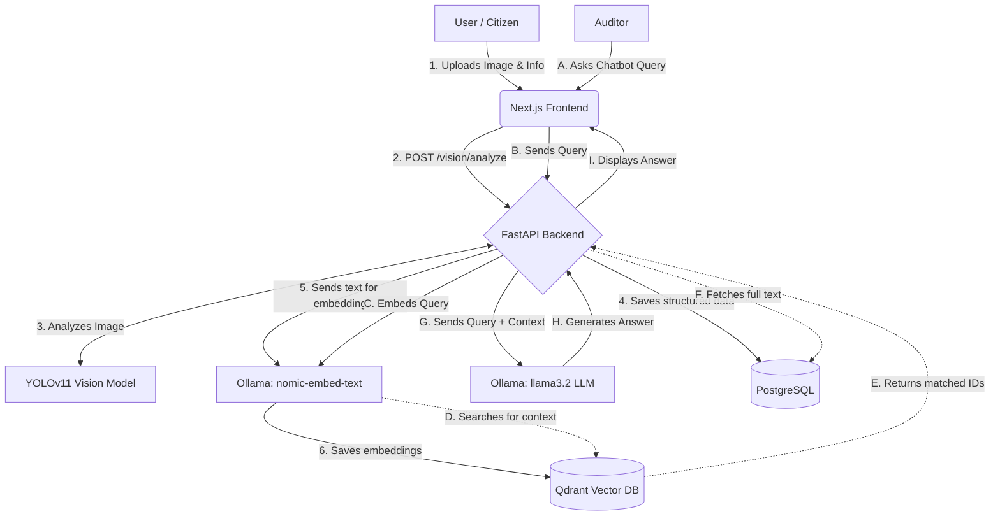

# EduAudit Architecture & Data Flow Guide

This document is structured to help you explain the inner workings of the EduAudit project clearly during your presentation or viva. 

## 1. System Architecture (The Tech Stack)

EduAudit is built on a modern, decoupled architecture separating the user interface, backend logic, relational data, and AI processing.

*   **Frontend (User Interface):** Built with **Next.js** (React) and TailwindCSS. It provides distinct views for Citizens (reporting) and Auditors (reviewing and chatting).
*   **Backend (API & Logic):** Built with **FastAPI** (Python). It acts as the central hub connecting the frontend to databases and AI models.
*   **Relational Database:** **PostgreSQL**. Used to store structured data like user profiles, complaint details, timestamps, and status updates.
*   **Vector Database (For RAG):** **Qdrant**. Used to store and search high-dimensional vector embeddings of complaints for the AI chatbot.
*   **AI Engine (Local/Offline):**
    *   **Vision (YOLOv11):** Analyzes uploaded images to detect specific damage types (like broken furniture, damaged walls, or dirty washrooms) and draws bounding boxes.
    *   **Embeddings (Ollama - `nomic-embed-text`):** Converts text complaints into mathematical vectors for similarity search.
    *   **LLM (Ollama - `llama3.2`):** The conversational brain that generates answers based on retrieved context.

---

## 2. Core Workflows & Data Flow

Here is how data moves through the system from start to finish.

### Flow A: Reporting an Issue (Vision AI & Storage)

When a user reports a problem, the system analyzes the evidence and stores it for auditing.

1.  **User Input:** The citizen uploads an image of the issue and provides a description/location (or speaks a voice note) via the Next.js frontend.
2.  **Vision Analysis:** 
    *   The frontend sends the image to the FastAPI backend (`POST /vision/analyze`).
    *   FastAPI passes the image to the **YOLOv11** object detection model.
    *   YOLOv11 scans the image, identifies the category of damage, and returns the bounding box coordinates.
3.  **Data Storage (PostgreSQL):** The verified complaint, along with the AI vision results, is saved into the PostgreSQL database.
4.  **Vectorization (Qdrant Indexing):** 
    *   In the background, the FastAPI server extracts the text description of the complaint.
    *   It sends this text to **Ollama** (`nomic-embed-text`), which translates the words into vector embeddings.
    *   These embeddings are saved in **Qdrant**. This is what makes the complaints "searchable" by the chatbot later.

### Flow B: The AI Chatbot (RAG - Retrieval-Augmented Generation)

When an auditor or user wants to query the database using natural language (e.g., *"How many broken furniture reports do we have in the IT Block?"*).

1.  **Query Submission:** The user types a question into the Next.js chatbot UI.
2.  **Query Vectorization:** FastAPI receives the query and sends it to **Ollama** to convert the question into a vector embedding.
3.  **Similarity Search (Qdrant):** 
    *   The backend searches **Qdrant** by comparing the question's vector against all stored complaint vectors. 
    *   Qdrant returns the most mathematically similar (relevant) complaints.
4.  **Data Retrieval (PostgreSQL):** The backend fetches the full textual details of those relevant complaints from PostgreSQL.
5.  **Answer Generation (LLM):** 
    *   FastAPI packages the user's original question AND the retrieved complaint data (the "Context") and sends it to **Ollama's `llama3.2` model**.
    *   The LLM reads the context and generates a precise, evidence-backed answer.
6.  **Response:** The answer is sent back to the frontend and displayed to the user.

---

## 3. Visual Data Flow (Mental Map)

## Viva Tip: What to Emphasize
If the examiner asks **"What makes this AI-powered?"** or **"Why not just use a standard search?"**, you can say:
> *"A standard database can only search for exact keyword matches. By using a RAG (Retrieval-Augmented Generation) architecture with Qdrant and Ollama, our system understands the semantic meaning behind complaints. Furthermore, our YOLOv11 integration automatically validates visual evidence before a human even looks at it, streamlining the auditor's workflow."*
